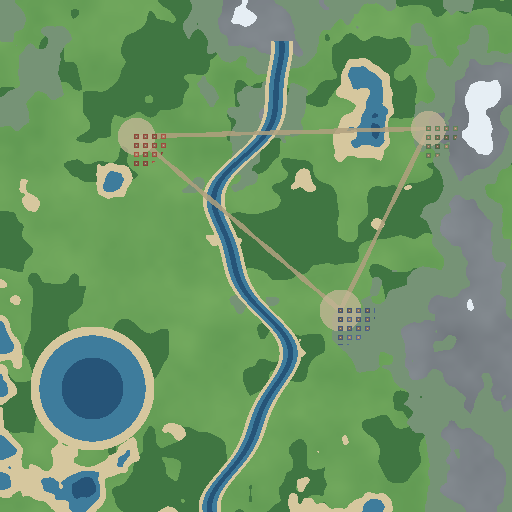

# Hypemap

Современная карта поселений для Minecraft-сервера на **Paper 1.21.3**.
Dynmap рендерит тайлы, Hypemap рисует над ними **свой интерфейс**: полигоны поселений,
живые игроки, поиск и полноценная админ-панель с рисованием границ.



```
Браузер ──► Cloudflare Pages (Vue 3 SPA + Pages Functions прокси)
                    │  /api/*   /up/*   /tiles/*
                    ▼
            Cloudflare Tunnel (без открытых портов)
                    │
      ┌─────────────┴──────────────┐
      ▼                            ▼
Hypemap (плагин, :8800)      Dynmap (:8123)
SQLite + REST + Marker API   тайлы, /up/*, аватарки
```

## Что умеет

**Публичная карта**

- 2D top-down тайлы Dynmap с плавным зумом и панорамированием (Leaflet + собственный tile layer,
  проекция считается из матриц `worldtomap`/`maptoworld`, которые отдаёт сам Dynmap).
- Живые игроки: голова, ник, координаты по клику; опрос `/up/world/<world>/<timestamp>`
  с интервалом из `/up/configuration` (родной механизм Dynmap, без WebSocket-хаков).
- Поселения — полигоны с заливкой, обводкой, названием и флагами; клик открывает карточку
  с владельцем, участниками, датой основания и площадью.
- Сайдбар: поиск по названию/игроку, фильтр по флагам, сортировка, скрытие/показ слоёв,
  переход к поселению с анимацией камеры.
- Переключение миров и карт (любая перспектива Dynmap, включая изометрию 60°).

**Админ-панель** (`/admin`, только после входа)

- CRUD поселений: название, описание, флаги, цвета (color picker), прозрачность, толщина линии,
  минимальный/максимальный зум, видимость.
- Участники: добавление по нику с автодополнением из кеша игроков сервера, роль OWNER/MEMBER.
- Рисование границы: клики по карте + правка вершин — перетаскивание, удаление по правому клику,
  вставка вершины в ребро, «лассо» (обводка области кликами), очистка.
- История изменений и откат к любой ревизии, скрытие/показ поселения, удаление.
- Аудит-лог действий, смена пароля, список пользователей.

**Бэкенд**

- REST API `GET/POST /api/towns`, `PUT/DELETE /api/towns/{id}` и расширения
  (`/visibility`, `/history`, `/restore`), защита JWT + роли ADMIN/EDITOR/VIEWER.
- SQLite как источник правды, синхронизация с **Dynmap Marker API**
  (`createAreaMarker` / `setCornerLocations` / `setFillStyle` / `setLineStyle`) — границы видны
  и в родном веб-интерфейсе Dynmap, и в других плагинах, которые читают маркеры.
- Работает без открытых портов: `127.0.0.1:8800` → Cloudflare Tunnel.

## Быстрый старт (демо без Minecraft-сервера)

```bash
cd web
npm ci
npm run tiles      # один раз: процедурные демо-тайлы 512×512 (нужен для оффлайна)
npm run build
npm run mock       # http://localhost:8080  — статика + мок API + мок Dynmap
```

Логин демо-админки: **admin / admin**. Мок-сервер живёт в памяти, данные сбрасываются при
перезапуске. Для живой разработки с горячей перезагрузкой: `npm run dev` (Vite проксирует
`/api`, `/up`, `/tiles` на `127.0.0.1:8080` — то есть на запущенный `npm run mock`).

## Структура репозитория

```
plugin/                    Paper-плагин (Maven, Java 21)
  src/main/java/net/hypemap/
    HypemapPlugin.java     точка входа, планировщик синхронизации
    config/Settings.java   чтение config.yml
    model/                 Town, TownPoint, TownMember, HistoryEntry, AuditEntry, User
    storage/               SQLite: Database, TownRepository, UserRepository, AuditRepository
    auth/                  PBKDF2-пароли, JWT HS256, проверка Cloudflare Access JWT, rate limit
    api/                   HttpServer, роутер, хендлеры, валидация, CORS
    dynmap/DynmapBridge.java  Marker API: createAreaMarker/setCornerLocations/setFillStyle/...
    service/PlayerCache.java  кеш игроков (главный поток Bukkit)
    commands/HypemapCommand.java  /hypemap info|reload|resync|passwd|role|users|backup

web/                       Vue 3 + TypeScript + Vite + Leaflet
  src/api/                 типы, fetch-клиент, эндпоинты, Dynmap JSON
  src/map/                 dynmapMath.ts (проекция/тайлы), MapEngine.ts (Leaflet-обёртка, редактор)
  src/stores/              Pinia: auth, server, towns, players, ui
  src/components/          AppHeader, MapCanvas, TownSidebar, TownDetails, TownForm, MemberInput…
  src/views/               MapPage, TownsPage, AdminPage, AdminEditorPage, NotFoundPage
  mock/                    мок API + Dynmap, сгенерированные демо-тайлы

worker/index.ts            Cloudflare Workers + Static Assets (дефолтный деплой)
functions/                 Cloudflare Pages Functions (альтернативный деплой)
  _lib/proxy.ts            единая логика проксирования + Cache API + Service Token
  _lib/security.ts         CSP и заголовки безопасности (общие для обоих режимов)
  _middleware.ts           подключение заголовков в Pages

scripts/gen-demo-tiles.ts  генератор демо-тайлов/аватарок (без внешних ассетов)
scripts/make-bundle.py     сборка zip-архива проекта (используется в CI-релизе)
docs/                      ARCHITECTURE.md, API.md, DEPLOY.md, DYNMAP.md
wrangler.toml              Workers + Static Assets (npx wrangler deploy)
wrangler.pages.toml        альтернатива: Cloudflare Pages
```

## Деплой

Пошаговая инструкция — **[docs/DEPLOY.md](docs/DEPLOY.md)**: установка Dynmap → сборка плагина
(`mvn -B clean package`) → Cloudflare Tunnel → Pages → Access. Кратко:

```bash
# 1. плагин
cd plugin && mvn -B clean package        # → target/Hypemap-1.0.0.jar

# 2. фронтенд + Cloudflare Workers (Static Assets)
cd web && npm ci && npm run build && cd ..
npx wrangler deploy                      # читает wrangler.toml

# альтернатива — Cloudflare Pages:
# npx wrangler pages deploy web/dist --config wrangler.pages.toml --project-name hypemap
```

В CI/дашборде Cloudflare обязательно настройте **Build command**:
`cd web && npm ci && npm run build` — без него `wrangler deploy` не найдёт `web/dist`
(ошибка «Could not detect a directory containing static files»).

## Документация

| Файл | О чём |
| --- | --- |
| [docs/ARCHITECTURE.md](docs/ARCHITECTURE.md) | решения, потоки данных, схема БД, безопасность, производительность |
| [docs/API.md](docs/API.md) | все эндпоинты с примерами `curl` |
| [docs/DEPLOY.md](docs/DEPLOY.md) | пошаговый деплой и диагностика |
| [docs/DYNMAP.md](docs/DYNMAP.md) | настройка Dynmap под top-down тайлы и Marker API |

## Ограничения и что дальше

- Тепловая карта активности (heatmap) не реализована: нужны данные о блоках/событиях,
  которых у Dynmap в `/up/*` нет — план: отдельная таблица агрегатов, которую наполняет
  слушатель `BlockBreakEvent`/`BlockPlaceEvent` в плагине.
- Discord-уведомления: точка расширения — `AuditRepository` (все изменения уже логируются).
- Границы хранятся как один внешний контур; вложенные области и «дырки» — следующая итерация.
- Мобильная адаптация сделана (сайдбар превращается в bottom-sheet), но редактор на телефоне
  требует аккуратной работы двумя пальцами.

## Лицензия

MIT — см. [LICENSE](LICENSE). Формулы проекции и идея tile layer вдохновлены Dynmap
(Apache-2.0) и LiveAtlas (Apache-2.0), см. [NOTICE](NOTICE).
