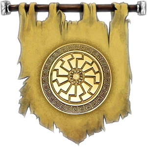
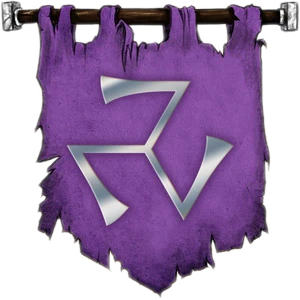
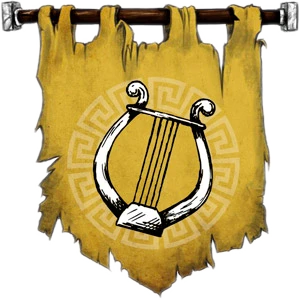
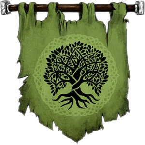
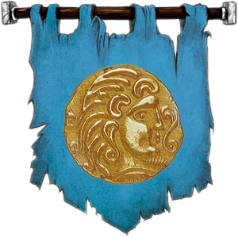
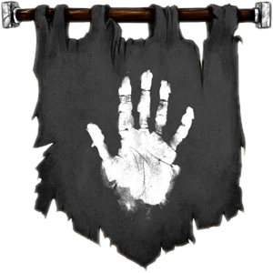
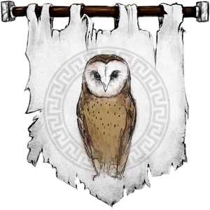
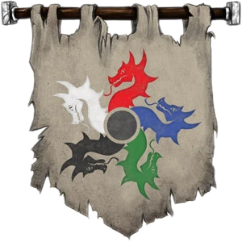
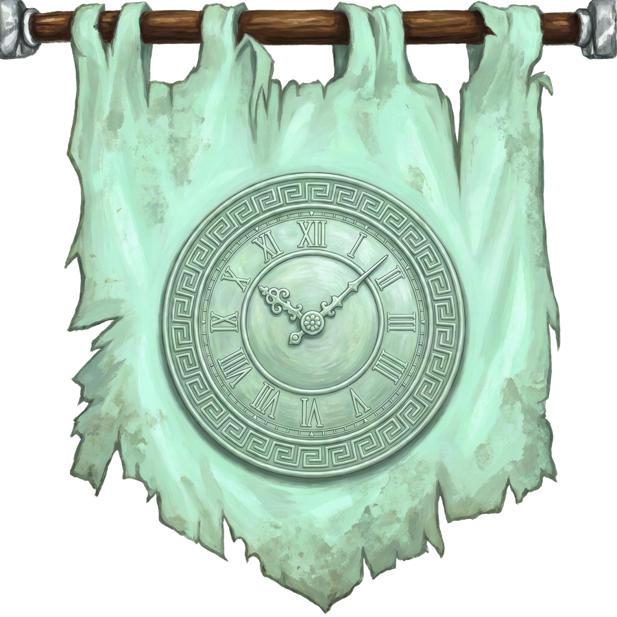
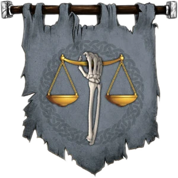

# Пантеон Десяти — боги мира

> Единый пантеон из десяти богов. Все они — части одного целого: свет и тьма, жизнь и смерть, порядок и хаос, пространство и время. Ни один бог не существует без остальных. Войны между церквями — это войны смертных; сами боги связаны узами, которые старше мира.
>
> Этот документ — лор + механики для D&D 5e. Каждый раздел самодостаточен: можно взять одного бога и играть только за него.

---

## Содержание

- [Космология и устройство пантеона](#космология-и-устройство-пантеона)
- [Календарь и общие праздники](#календарь-и-общие-праздники)
- [1. Од — Бог света и жизни](#1-од--бог-света-и-жизни)
- [2. Тритерион — Бог войны](#2-тритерион--бог-войны)
- [3. Аполлон — Бог знаний и обмана](#3-аполлон--бог-знаний-и-обмана)
- [4. Фрейя — Богиня природы](#4-фрейя--богиня-природы)
- [5. Фрей — Бог изобилия](#5-фрей--бог-изобилия)
- [6. Юртрус — Бог смерти](#6-юртрус--бог-смерти)
- [7. Мериад — Бог космоса](#7-мериад--бог-космоса)
- [8. Сархар — Бог драконов](#8-сархар--бог-драконов)
- [9. Хронос — Бог времени](#9-хронос--бог-времени)
- [10. Имодиум — Бог правосудия](#10-имодиум--бог-правосудия)
- [Приложение А. Сводная таблица для DM](#приложение-а-сводная-таблица-для-dm)
- [Приложение Б. Отношения богов](#приложение-б-отношения-богов)
- [Приложение В. Как играть за жреца](#приложение-в-как-играть-за-жреца)

---

## Космология и устройство пантеона

### Как возник мир

В начале не было ничего, кроме **Пустоты**. Из Пустоты проступили двое: **Мериад** (пространство, звёзды, бесконечность) и **Хронос** (время, течение, мера). Пока не было времени — нечему было длиться; пока не было пространства — негде было быть. Их союз дал миру **течение**: прошлое, настоящее и будущее.

Затем мир наполнился: **Од** дал свет и первую жизнь, **Фрейя** — дикую природу, **Фрей** — урожай и изобилие, **Сархар** — драконов, первых владык плоти, **Аполлон** — разум, язык и хитрость, **Тритерион** — войну и порядок в строю, **Юртрус** — смерть как конец и границу, **Имодиум** — закон и суд, чтобы смерть и жизнь не смешивались без меры.

Поэтому пантеон — это не десять случайных богов, а **десять сил, без которых мир рассыплется**:

| Пара | Что держит | Напряжение |
|---|---|---|
| Мериад ↔ Хронос | Пространство ↔ Время | Бесконечность vs течение |
| Од ↔ Юртрус | Жизнь ↔ Смерть | Милость vs граница |
| Фрейя ↔ Фрей | Дикая природа ↔ Культивируемое изобилие | Свобода vs урожай |
| Тритерион ↔ Имодиум | Война ↔ Правосудие | Победа vs закон |
| Аполлон ↔ Сархар | Разум и обман ↔ Сила и гордость | Хитрость vs мощь |

Смертные часто ссорятся внутри этих пар. Боги — нет. Жрец Ода и жрец Юртруса могут спорить о том, спасать ли умирающего, но оба знают: без смерти жизнь бессмысленна, без жизни смерти некого встречать.

### Где живут боги

У каждого бога есть **домен** — кусок реальности, где его власть полна. Смертные редко туда попадают. Храмы на земле — не дома богов, а **двери**: места, где домен касается мира.

- Од — **Золотой Сад**: бесконечный сад с Древо Жизни, где никогда не ночь.
- Тритерион — **Пурпурный Зал**: вечный военный лагерь, где знамёна не падают.
- Аполлон — **Театр Масок**: город-лабиринт из библиотек и сцен, где все говорят загадками.
- Фрейя — **Дикий Лес**: лес без троп, где время идёт по-своему.
- Фрей — **Солнечное Поле**: вечная жатва, золотые поля и амбары без дна.
- Юртрус — **Чёрный Порог**: тихий зал без окон, где все двери ведут в одну сторону.
- Мериад — **Звёздная Монета**: бесконечная сфера с картой всех звёзд.
- Сархар — **Пять Тронов**: вулканическая кальдера, где пять драконов сидят вокруг пустого шестого трона.
- Хронос — **Башня Часов**: башня, в которой каждый этаж — эпоха.
- Имодиум — **Зал Весов**: суд, в котором дело никогда не закрывается, пока не взвешено.

### Как боги общаются со смертными

Боги не кричат с неба. Они говорят через:

- **Знаки** — сны, совпадения, странные сны в ночь праздника.
- **Чудеса** — исцеление, знамение, проклятие. Чем сильнее чудо, тем дороже цена.
- **Жрецов** — но жрец может ошибиться. Церковь — не бог.
- **Баннеры** — каждый бог имеет знамя-символ. Его вывешивают на храме, носят в бой, ставят на могилу. Сжечь чужое знамя — объявление войны. Украсть — святотатство.

### Общие правила веры

1. **Все десять — истинны.** Отрицать существование другого бога — ересь в любой церкви. Можно не любить, можно воевать, но нельзя говорить «его нет».
2. **Свобода совести.** Каждый смертный волен выбрать бога. Принуждение к вере — грех против всех десяти (кроме, по мнению некоторых, Тритериона — но и он требует клятвы, а не рабства).
3. **Клятва сильнее церкви.** Если жрец нарушил учение бога, но сохранил клятву — он всё ещё жрец. Если наоборот — он отступник, даже если носит рясу.
4. **Мёртвые принадлежат всем.** Похоронные обряды могут вести жрецы любого бога, но последнее слово — за Юртрусом. Никто не вправе удерживать душу против её пути.

---

## Календарь и общие праздники

Год — 12 месяцев по 30 дней + 5 дней без имён (**Пять Тихих Дней** в конце года, когда все храмы закрыты и молчат).

| Месяц | Название | Покровитель |
|---|---|---|
| 1 | Первый Свет | Од |
| 2 | Пурпурная Луна | Тритерион |
| 3 | Маска | Аполлон |
| 4 | Лист | Фрейя |
| 5 | Жатва | Фрей |
| 6 | Тихий Порог | Юртрус |
| 7 | Звезда | Мериад |
| 8 | Чешуя | Сархар |
| 9 | Песок | Хронос |
| 10 | Весы | Имодиум |

**Общие праздники (все церкви):**

- **Пять Тихих Дней** — никто не работает, не воюет, не судит. Только молчание и поминки. Нарушивший тишину — под судом всех церквей.
- **Ночь Десяти Огней** (первая ночь года) — десять костров, по одному на каждого бога. Каждый кладёт в огонь что-то своё: Од — цветок, Юртрус — свечу, Сархар — уголь. Огонь не гасят до рассвета.
- **День Дорог** (15-го числа каждого месяца) — день, когда все дороги считаются общими: путника нельзя ограбить, в долг не отказывают, ночлег дают бесплатно.

---

## 1. Од — Бог света и жизни

**Мировоззрение:** Законно-добрый
**Домены:** Свет, Жизнь, Исцеление, Рассвет, Сады
**Символ:** Чёрное Древо Жизни на зелёном знамени (корни — в землю, крона — в небо)
**Цвета:** Зелёный, золотой, белый
**Священный день:** Первый день месяца (рассвет)
**Священное:** Дуб, яблоня, пчёлы, голуби, утренний свет
**Священное число:** 1 и 7
**Священное оружие:** Булава, молот, посох с кристаллом
**Покровитель:** Целителей, садовников, детей, путников на рассвете, тех, кто сеет

### Суть и миф

Од — первый, кто сказал «да будет свет». Он не создал мир из ничего — он **зажёг** его. До Ода мир был серым и холодным. Од посадил Древо Жизни и сказал: «Пока это дерево растёт, жизнь не исчезнет».

Од — не воин и не судья. Он — **садовник**. Его чудо — не победа, а **продолжение**: ребёнок, который выжил; рана, которая затянулась; семя, которое проросло сквозь камень. Поэтому его жрецы ненавидят бессмысленное убийство, но не ненавидят врагов — они их **лечат**, даже после битвы.

> «Свет не спорит с тьмой. Он просто встаёт. И тьма отступает сама.» — пословица Ода.

### Учение — Пять Заповедей Ода

1. **Жизнь священна, даже вражеская.** Убить можно только защищаясь. Добивать раненого — грех.
2. **Исцеляй прежде, чем суди.** Сначала спаси, потом разберись, кто прав.
3. **Сажай то, что переживёт тебя.** Дерево, сад, ребёнка, доброе дело. Бессмертие — в плодах.
4. **Свет не должен слепить.** Не навязывай добро силой. Предложи — и отойди.
5. **Рассвет — каждый день.** Прощай. Начинай сначала. Вчерашняя тьма не должна красть сегодняшний свет.

### Традиции и повседневная жизнь

- **Рассветная молитва.** Каждый последователь встречает рассвет лицом к востоку, с ладонями вверх. Даже 30 секунд — достаточно. Пропустил — не грех, но день считается «незавершённым».
- **Дерево Ода.** В каждом дворе, где живут последователи, сажают дерево (яблоню, дуб, рябину). На свадьбу, рождение, выздоровление — сажают новое. Вырубленное дерево без разрешения семьи — тяжёлый грех.
- **Садовая десятина.** Каждый последователь отдаёт церкви один день в месяц на работу в общем саду, больнице или приюте. Не деньгами — руками.
- **Белый хлеб на рассвете.** В первый день месяца пекут круглый хлеб с крестом из теста и раздают соседям, даже врагам.
- **Имена света.** Детей часто называют в честь растений или света: Светлана, Заря, Рябина, Дуб, Яблоня. Но имя — не приказ: ребёнок может выбрать другое.
- **Запрет на ночные казни.** Последователи Ода не участвуют в казнях ночью и не благословляют их. Казнь — только днём, только по закону (и то — с молитвой о душе).

### Церковные обряды и ритуалы

**Ежедневный — Рассветный круг (5 минут)**
Жрец и прихожане встают в круг, держась за руки, лицом к востоку. Жрец читает: «Од зажёг свет — и мы не погаснем». Все отвечают: «Не погаснем». Затем каждый называет одно живое существо, за которое благодарит. Круг распускается с рассветом.

**Еженедельный — Садовая служба**
В седьмой день недели — работа в саду/больнице, затем общая трапеза из плодов сада. Никаких проповедей дольше 10 минут: учение должно быть коротким, как рассвет.

**Главный праздник — Первый Свет (1-е число месяца)**
Ночь без сна: храмы открыты, внутри горят тысячи свечей. В полночь жрецы выходят на крышу и бьют в колокола до рассвета. На рассвете — посадка общего дерева года. Кто посадил дерево — его имя вырезают на табличке у корней. Праздник заканчивается хлебом и мёдом.

**Обряд инициации — Посвящение в Садовники**
Новичок проводит ночь в саду без еды, затем сажает саженец и поливает его водой из семи источников. Жрец повязывает ему на запястье нить из шерсти с узелком. Узелок нельзя снимать, пока дерево не приживётся. Если дерево погибло — новичок сажает другое и не считается отступником: Од прощает.

**Особый обряд — Исцеление**
Жрец кладёт руки на больного, читает заповедь №2 и не отпускает, пока не убедится, что больной дышит ровно. Если больной умирает — жрец не отходит: сидит рядом до последнего вздоха и затем сажает цветок на могиле. Уход за умирающими — высший долг, выше спасения живых.

**Погребальный обряд**
Тело хоронят в саду или у дерева, лицом к востоку. На могилу кладут яблоко и монету. Говорят: «Корни помнят. Крона ждёт».

### Боевой стиль последователей

**Философия:** Защита жизни, а не победа. Жрец Ода в бою — **щит**. Он не ищет врага, он встаёт между врагом и тем, кого защищает.

**Оружие и броня:**
- Булава, молот, посох, копьё с тупым наконечником (можно оглушить, не убивая).
- Тяжёлая броня, щит. Оружие освящают на рассвете: на рукоять вырезают листок.
- Дальнобойное — только для защиты (праща, лук). Огненное оружие — табу: огонь Ода — свет, а не пламя войны.

**Магия:**
- Заклинания света и исцеления: *cure wounds, bless, sanctuary, radiant smite, revivify* (только с согласия души).
- Запрещены: некромантия, заклинания, убивающие без разбора, *fireball* в жилых местах.
- Фирменный приём — **«Рассветный щит»**: жрец вонзает посох в землю, вокруг вырастает круг света (аналог *spirit guardians* в виде светящихся корней). Внутри круга враги не могут добить союзников.

**Тактика:**
- Всегда есть план отступления и эвакуации раненых. Победа без спасения своих — поражение.
- После боя — обязательный обход раненых, включая врагов. Отказ лечить врага — грех, если только он не продолжает бой.
- Один раз в бой жрец может **отдать свою жизнь** вместо союзника (механика: *Death Ward* + добровольное падение до 0 HP). Церковь считает это не подвигом, а долгом.

**D&D-подсказки:** Клерик (Life / Light), Паладин (Devotion), Друид (Dreams). Черта: *Healer*, *Inspiring Leader*.

### Жрецы и иерархия

- **Садовник** — новичок, носит зелёную нить.
- **Хранитель** — ведёт службы, носит белую рясу с вышитым деревом.
- **Светонос** — глава храма, носит золотую ветвь.
- **Первый Садовник** — глава церкви в регионе. Выбирается не голосованием, а **жребием из тех, кто служил дольше всех**. Од не любит честолюбия.

Одеяния — простые, из льна. Золото — только в праздник. Жрец Ода не носит чёрного, кроме как на похоронах.

### Табу и грехи

- Убийство ради добычи, добивание, казнь без суда.
- Вырубка деревьев без нужды, отравление земли и воды.
- Отказ в помощи умирающему.
- Ночные пытки и допросы (свет не должен мучить).

### Отношения с другими богами

- **Юртрус** — уважает как границу, но спорит о каждом спасении. Жрецы Ода и Юртруса часто работают вместе в больницах: один лечит, другой провожает.
- **Имодиум** — союзник в судах, но Од просит милости там, где Имодиум требует закона.
- **Фрейя и Фрей** — братья по саду. Од благословляет их поля, они кормят его бедных.
- **Тритерион** — терпит как необходимость, но молится, чтобы война кончилась.

### Храмы

Храм Ода — **сад с часовней**: открытое пространство, в центре — Древо Жизни (настоящее или каменное). Крыши нет или она стеклянная — свет должен попадать внутрь. Внутри всегда пахнет мёдом и травами. Больница и приют — обязательная часть храма, не пристройка.

---

## 2. Тритерион — Бог войны

**Мировоззрение:** Законно-злой
**Домены:** Война, Дисциплина, Победа, Порядок в строю, Честь знамён
**Символ:** Серебряный трезубец-знак на пурпурном знамени (три зубца — строй, щит и меч)
**Цвета:** Пурпурный, серебристый, чёрный
**Священный день:** День полнолуния (ночь строевого смотра)
**Священное:** Копьё, щит, знамя, барабан
**Священное число:** 3
**Священное оружие:** Копьё, алебарда, боевой строй
**Покровитель:** Солдат, командиров, стражей, тех, кто держит строй

### Суть и миф

Тритерион — бог, который **выиграл первую войну**. До него войны были резнёй. Он научил людей **стоять в строю, держать щит соседа и не бросать знамя**. Его закон прост: **порядок побеждает хаос, дисциплина побеждает страх**.

Тритерион — законно-злой не потому, что любит зло, а потому что **война — это зло, и её надо вести по правилам, чтобы она кончилась**. Он разрешает хитрость, засады, осадную войну — но запрещает бессмысленную жестокость, потому что она ломает строй и проигрывает войны.

> «Война — это не ярость. Война — это строй. Кто не держит строй — уже проиграл.»

### Учение — Кодекс Строя

1. **Держи строй.** Свой — свой. Знамя — святыня. Бросивший знамя — предатель.
2. **Победа — цель, честь — путь.** Побеждай любыми средствами, но не унижай побеждённого без нужды.
3. **Приказ — закон.** Пока приказ не отдан командиром, он не обсуждается. После боя — обсуждается всё.
4. **Слабый под защитой сильного.** Сильный не бьёт слабого вне боя. В бою — бьёт, иначе умрёт сам.
5. **Война должна кончиться.** Каждый бой — шаг к миру. Вечная война — грех против Тритериона.

### Традиции и повседневная жизнь

- **Утренний строй.** Даже в мирное время последователи встают в строй на рассвете, называют имя, звание и клятву. Для гражданских — это просто утренняя зарядка с клятвой.
- **Знамя в доме.** В каждом доме последователя висит маленькое пурпурное знамя с трезубцем. Его нельзя ронять на пол, нельзя вешать вверх ногами.
- **Три удара барабана.** Перед едой, перед сном, перед выходом — три удара. Напоминание: строй, щит, меч.
- **Имена по порядку.** Детей называют по порядку рождения: Первый, Второй, Третий — или по знакам: Копьё, Щит, Знамя. Взрослое имя дают после первого боя или службы.
- **Запрет на дуэли без свидетелей.** Дуэль — это бой по правилам, значит — с судьёй, строем и знамёном. Убийство из-за угла — не дуэль, а трусость.

### Церковные обряды и ритуалы

**Ежедневный — Перекличка (3 минуты)**
Жрец бьёт в барабан три раза. Все отвечают: «Строй! Щит! Меч!» Затем называют свой долг на сегодня. Пропустивший перекличку без причины — штраф работой на храм.

**Еженедельный — Строевой день**
Учения, марш, проверка оружия. После — разбор ошибок. Жрец не хвалит за победу, он разбирает **ошибки**, даже если победили.

**Главный праздник — Ночь Знамени (полнолуние)**
Все знамёна выносят на площадь. Жрец читает имена павших за год. Каждое имя — удар барабана. Затем — клятва: «Мы держим строй». Знамя года, которое не упало ни разу, вешают в храме.

**Обряд инициации — Клятва Строя**
Новичок встаёт в строй с копьём и щитом, держит их до рассвета. На рассвете жрец вручает ему знамя с его именем. С этого момента он — часть строя. Отступить — можно только с приказом.

**Особый обряд — Суд Строя (военный трибунал)**
Если солдат нарушил кодекс, его судят не жрец, а **строй**: сослуживцы голосуют. Наказание — от выговора до изгнания из строя (хуже смерти для последователя). Смертная казнь — только за предательство знамени.

**Погребальный обряд**
Воина хоронят в строю: щит на груди, копьё в руке, знамя над могилой. Говорят: «Строй не забывает».

### Боевой стиль последователей

**Философия:** Победа через порядок. Один воин — слаб. Строй — непобедим.

**Оружие и броня:**
- Копьё, алебарда, щит, меч. Двуручное оружие — только для чемпионов строя.
- Тяжёлая броня, одинаковая для всего строя (единообразие — часть дисциплины).
- Осадное оружие, тараны, лестницы — священны, как и мечи.

**Магия:**
- Заклинания порядка и защиты: *bless, shield of faith, warding bond, banishment* (изгнать врага из строя).
- Боевая магия — **тактическая**, не разрушительная: замедлить врага, укрепить строй, дать приказ на расстоянии (*sending* как военный приказ).
- Фирменный приём — **«Пурпурный строй»**: жрец чертит трезубец на земле, союзники внутри получают +2 к AC и не могут быть окружены (аналог *spirit guardians* + *sanctuary*).

**Тактика:**
- Всегда: авангард, строй, резерв. Никогда не бросать резерв в первый бой.
- Отступление — тоже строй, а не бегство. Паника — грех.
- Пленных не убивают: их судят. Убийство пленных — предательство знамени.
- После победы — немедленный подсчёт потерь и похороны. Не похоронивший врагов — не победитель, а мародёр.

**D&D-подсказки:** Паладин (Conquest / Watchers), Воин (Battle Master), Клерик (War / Order). Черта: *Polearm Master*, *Sentinel*, *Inspiring Leader*.

### Жрецы и иерархия

- **Рекрут** — носит серую ленту.
- **Строевой** — ведёт перекличку, носит пурпурную перевязь.
- **Знаменосец** — хранит знамя храма, носит серебряный трезубец.
- **Маршал** — глава церкви. Выбирается командирами, а не жрецами: Тритерион доверяет тем, кто воевал.

Жрец Тритериона обязан уметь держать строй. Не умеет — не жрец.

### Табу и грехи

- Бросить знамя, бежать из строя без приказа.
- Убить пленного, добить раненого без нужды.
- Вечная война ради войны.
- Приказ, унижающий строй без военной нужды (командир тоже судим).

### Отношения с другими богами

- **Имодиум** — ближайший союзник: война и закон. Вместе судят предателей.
- **Юртрус** — союзник в похоронах и границах. Тритерион даёт ему воинов, Юртрус — покой.
- **Од** — уважает, но спорит: Од хочет спасать врагов, Тритерион — побеждать.
- **Сархар** — презирает как хаос, но боится как силу. Война с драконами — особый обряд.

### Храмы

Храм Тритериона — **зал-казарма**: каменный зал, где вдоль стен стоят знамёна, в центре — барабан и карта войн. Никаких украшений, кроме знамён. Кузница — обязательна: оружие освящают здесь, а не в часовне.

---

## 3. Аполлон — Бог знаний и обмана

**Мировоззрение:** Хаотично-нейтральный
**Домены:** Знания, Обман, Искусство, Музыка, Судьба, Истина
**Символ:** Белая лира на золотом знамени (четыре струны — правда, ложь, красота, игра)
**Цвета:** Золотой, белый, чёрный (маска)
**Священный день:** День маскарада (каждый 13-й день месяца)
**Священное:** Лира, маска, книга, игральные кости, зеркало
**Священное число:** 4
**Священное оружие:** Рапира, короткий лук, кинжал
**Покровитель:** Учёных, поэтов, воров, шпионов, игроков, тех, кто ищет истину

### Суть и миф

Аполлон — бог, который **знает всё и врёт красиво**. Он дал людям разум, а затем научил их **играть** с разумом: загадки, маски, театр, шахматы. Его истина — не в том, что сказано, а в том, что **понято**.

Аполлон хаотично-нейтрален, потому что **знание не добро и не зло**. Знание — инструмент. Обман — тоже инструмент. Вопрос — в чьих руках. Поэтому его церковь принимает и учёных, и воров, и шпионов — лишь бы они **играли честно**, то есть по правилам игры.

> «Правда без игры — скучна. Игра без правды — пуста. Аполлон любит и то, и другое.»

### Учение — Правила Игры

1. **Знание — свобода.** Не прячь знание от того, кто ищет. Но и не давай его бесплатно: цена — уважение.
2. **Обман — искусство.** Ври красиво, ври ради игры, ври ради истины. Ври ради подлости — грех.
3. **Маска — честнее лица.** Иногда маска говорит правду, а лицо врёт. Учись различать.
4. **Играй по правилам.** Даже хаос имеет правила. Нарушил правила игры — ты не игрок, ты мошенник.
5. **Смех — молитва.** Если ты не можешь посмеяться над собой — ты не понял Аполлона.

### Традиции и повседневная жизнь

- **Маска в кармане.** Каждый последователь носит маленькую маску. Надел — значит, говорит не от себя, а от роли. Снял — говорит честно. Снимать маску в споре — знак доверия.
- **День загадок.** Каждый 13-й день — день, когда все говорят загадками. Отвечать прямо — невежливо. Победитель загадок получает книгу или инструмент.
- **Книга долгов.** Каждый последователь ведёт «книгу» — что он узнал, что он скрыл, кому он должен. Книгу показывают жрецу раз в месяц. Скрыл долг — грех.
- **Имена ролей.** У последователей часто два имени: настоящее и сценическое. Сценическое используют в игре, торговле, шпионаже.
- **Запрет на клятвы без игры.** Клятва без свидетелей и без ставки — пустые слова. Аполлон не слушает пустых слов.

### Церковные обряды и ритуалы

**Ежедневный — Утренняя загадка (1 минута)**
Жрец загадывает загадку. Все отвечают шёпотом. Ответ не важен — важен **ход мысли**. Кто ответил первым — ведёт следующий день.

**Еженедельный — Театр**
Пьеса, концерт или игра. Жрец не проповедует — он **ставит спектакль**, где учение показано, а не рассказано. Зрители голосуют за лучший ход.

**Главный праздник — Маскарад (13-й день)**
Все надевают маски и говорят только в масках. Жрец в маске Судьи судит споры игрой: бросает кости, загадывает загадки, назначает ставки. Проигравший в игре не платит деньгами — он **рассказывает свою тайну**. Тайна — валюта Аполлона.

**Обряд инициации — Игра на лире**
Новичок должен сыграть на лире (или спеть, или рассказать историю) перед храмом. Неважно, красиво ли — важно, **честно ли**. Затем ему дарят маску. Маска без игры — просто кусок дерева.

**Особый обряд — Суд Загадок**
Спор, который нельзя решить законом, решают загадкой. Проигравший выполняет желание победителя (в пределах разума). Имодиум не любит этот обряд, но Аполлон настаивает: **не всё решается весами**.

**Погребальный обряд**
Умершего хоронят с маской на лице и лирой в руках. Говорят: «Игра окончена. Маска снята».

### Боевой стиль последователей

**Философия:** Победа через хитрость. Не бей сильнее — бей **неожиданно**.

**Оружие и броня:**
- Рапира, кинжал, короткий лук, дротики. Тяжёлая броня — табу: она сковывает.
- Лёгкая броня, плащ, маска как шлем (даёт +1 к запугиванию, если надета).
- Яды, дымовые шашки, верёвки, крюки — священны, как мечи.

**Магия:**
- Иллюзии, обман, предвидение: *minor illusion, misty step, invisibility, disguise self, suggestion, hold person*.
- Боевая магия — **контроль**, а не урон: заставить врага промахнуться, исчезнуть, поверить, что бой уже проигран.
- Фирменный приём — **«Маска Аполлона»**: жрец надевает маску, все враги в радиусе видят его в виде того, кого боятся (аналог *mirror image* + *fear*). Пока маска надета, жрец не может говорить прямо — только загадками.

**Тактика:**
- Никогда не вступать в честный бой, если можно устроить засаду, ловушку или обман.
- Всегда есть запасной план, запасной выход и запасная маска.
- Пленных не убивают — их **выменивают** на знание. Знание дороже жизни.
- После боя — смех. Не смеёшься — значит, было нечестно.

**D&D-подсказки:** Разбойник (Arcane Trickster), Бард (Lore / Glamour), Волшебник (Illusion / Divination), Клерик (Trickery / Knowledge). Черта: *Skilled*, *Lucky*.

### Жрецы и иерархия

- **Игрок** — новичок, носит маску на шее.
- **Мастер масок** — ведёт игры, носит маску на лице.
- **Хранитель струн** — хранит лиру храма, носит золотую струну.
- **Первый Игрок** — глава церкви. Выбирается **игрой в кости** из трёх кандидатов: Аполлон не любит выборов, он любит жребий.

Жрец Аполлона обязан знать хотя бы один инструмент и одну игру. Не умеет играть — не жрец.

### Табу и грехи

- Обман ради подлости, предательство без игры.
- Сокрытие знания от ищущего (если только знание не опасно).
- Клятва без ставки.
- Игра с шулерством (нарушение правил игры).

### Отношения с другими богами

- **Имодиум** — вечный спор: Аполлон хочет судить загадками, Имодиум — весами. Иногда Аполлон выигрывает.
- **Сархар** — восхищается силой, но боится. Драконы не играют — они **берут**.
- **Од** — дружит: Од лечит, Аполлон рассказывает истории у кровати больного.
- **Хронос** — уважает: время — главная загадка.

### Храмы

Храм Аполлона — **театр с библиотекой**: сцена в центре, книги по стенам, маски на дверях. Никаких алтарей — только сцена и стол для игры. Жрец сидит не за алтарём, а **за столом**.

---

## 4. Фрейя — Богиня природы

**Мировоззрение:** Хаотично-добрый
**Домены:** Дикая природа, Лес, Животные, Свобода, Циклы, Луна
**Символ:** Сова на белом знамени (сова видит в темноте, где другие слепы)
**Цвета:** Белый, коричневый, зелёный
**Священный день:** Полнолуние (ночь леса)
**Священное:** Сова, дуб, река, лунный свет, дикие ягоды
**Священное число:** 2 (луна, пара, цикл)
**Священное оружие:** Посох, праща, когти, зубы
**Покровитель:** Друидов, следопытов, зверей, детей леса, тех, кто живёт дико

### Суть и миф

Фрейя — богиня, которая **не строит храмы**. Её храм — лес. Её жрецы — те, кто **слушает**, а не командует. Она хаотично-добрая, потому что природа **не знает законов**: она не добрая и не злая, она **живая**. А жизнь, по Фрейе, — всегда добра, даже когда убивает.

Фрейя — не Фрей. Фрей — бог **урожая**, полей и амбаров. Фрейя — бог **дикого**: леса, где никто не сеял, рек, где никто не строил плотин, зверей, которых никто не приручил. Поэтому её последователи иногда конфликтуют с фермерами: лес vs поле.

> «Природа не прощает и не наказывает. Она просто продолжает расти. Даже сквозь ваши могилы.»

### Учение — Законы Леса

1. **Слушай, прежде чем руби.** Лес говорит. Кто не слушает — тот уже проиграл.
2. **Бери только то, что нужно.** Охота ради спорта — грех. Охота ради жизни — обряд.
3. **Дикое — свободно.** Не приручай то, что должно быть диким. Не строй плотин на живых реках.
4. **Цикл — закон.** Родился — вырос — умер — стал землёй. Не пытайся остановить цикл.
5. **Доброта — это забота.** Не жалость, а забота: накорми, вылечи, отпусти.

### Традиции и повседневная жизнь

- **Лунная тишина.** В полнолуние — ночь тишины в лесу: без оружия, без громких слов. Только слушать сов и воду.
- **Дерево-имя.** Каждый последователь сажает дерево и называет его своим именем. Пока дерево растёт — человек живёт в лесу. Срубил чужое дерево — изгнан.
- **Ягоды для зверей.** Собирая ягоды, оставляй треть на кусте — для птиц и зверей. Собирающий всё — жадный, а жадность — грех.
- **Следы на земле.** На тропах последователи оставляют знак совы из веток — «здесь прошли свои». Знак нельзя ломать.
- **Имена зверей.** Детей называют в честь животных: Сова, Лиса, Медведь, Волк. Но имя — не клетка: ребёнок может выбрать другое.

### Церковные обряды и ритуалы

**Ежедневный — Слушание (10 минут)**
Жрец и прихожане сидят в лесу или у реки, молчат и слушают. Затем каждый называет, что он услышал: ветер, птицу, воду. Не услышал ничего — тоже честно.

**Еженедельный — Тропа**
Прогулка по лесу с жрецом. Жрец показывает следы, травы, гнёзда. Учение — через **показ**, а не проповедь.

**Главный праздник — Ночь Совы (полнолуние)**
Все собираются в лесу, зажигают только лунный свет (без факелов). Жрец в маске совы рассказывает историю года: что родилось, что умерло, что изменилось. Затем — **обряд отпускания**: каждый отпускает в небо или воду что-то, что его держит (письмо, камень, обещание).

**Обряд инициации — Ночь в лесу**
Новичок проводит ночь в лесу один, без оружия и еды. На рассвете он должен назвать животное, которое его посетило (или сон). Жрец дарит ему посох с вырезанной совой. Посох нельзя использовать для убийства.

**Особый обряд — Охота с благодарностью**
Перед охотой — молитва: «Фрейя, дай нам жизнь, мы вернём жизнь земле». После охоты — похороны животного, благодарность, использование всего: мясо, кости, шкура. Выбросивший добычу — грех.

**Погребальный обряд**
Умершего хоронят в лесу, без гроба, лицом к луне. На могилу кладут ветку и ягоду. Говорят: «Лес примет. Лес вернёт».

### Боевой стиль последователей

**Философия:** Защита дикого. Не наступать — **не давать разрушать**.

**Оружие и броня:**
- Посох, праща, лук, когти, зубы. Мечи — только для защиты, не для рубки леса.
- Кожаная броня, плащ из листьев, амулеты из костей и перьев.
- Огонь — только для тепла, не для выжигания леса.

**Магия:**
- Магия природы и зверей: *goodberry, speak with animals, entangle, faerie fire, call lightning* (как гнев леса).
- Боевая магия — **защита территории**: корни, туман, шипы, призыв зверей.
- Фирменный приём — **«Гнев леса»**: жрец бьёт посохом по земле, вокруг вырастают корни и шипы (аналог *spike growth* + *entangle*). Внутри круга лес не даёт врагам пройти.

**Тактика:**
- Всегда: знать лес, знать тропы, знать, где спрятаться. Лес — союзник.
- Не вступать в бой на чужой территории без нужды. Лес не любит чужаков.
- Животных не убивать без нужды. Убивший зверя ради забавы — изгнан.
- После боя — восстановить лес: посадить деревья, убрать мусор. Победа без восстановления — поражение.

**D&D-подсказки:** Друид (Circle of the Moon / Stars), Следопыт (Gloom Stalker), Клерик (Nature / Twilight). Черта: *Druidic Warrior*, *Observant*.

### Жрецы и иерархия

- **Слушатель** — новичок, носит ветку.
- **Хранитель троп** — ведёт службы, носит плащ с перьями совы.
- **Голос леса** — глава храма, носит маску совы.
- **Первая Сова** — глава церкви. Выбирается **совaми**: жрецы оставляют еду в лесу, чья сова прилетела первой — тот и глава. Фрейя не любит голосований.

Жрец Фрейи обязан знать лес. Не знает троп — не жрец.

### Табу и грехи

- Вырубка леса без нужды, строительство плотин, осушение болот.
- Охота ради спорта, приручение диких зверей против их воли.
- Использование огня для уничтожения леса.
- Шум в лесу ночью без нужды.

### Отношения с другими богами

- **Фрей** — брат по природе, но спор: Фрейя — дикое, Фрей — поле. Вместе они — вся природа.
- **Од** — союзник: Од сажает сады, Фрейя — леса. Од лечит людей, Фрейя — зверей.
- **Сархар** — боится: драконы жгут леса. Но уважает: драконы — тоже дикие.
- **Тритерион** — не любит: война разрушает лес. Но понимает: лес тоже воюет.

### Храмы

Храм Фрейи — **роща с хижиной**: никаких каменных зданий. Хижина жреца, круг камней, деревья. Алтарь — **пень**. Жрец сидит на пне, а не за столом. Внутри всегда пахнет мхом и дымом.

---

## 5. Фрей — Бог изобилия

**Мировоззрение:** Хаотично-добрый
**Домены:** Изобилие, Урожай, Процветание, Торговля, Солнце, Праздник
**Символ:** Солнечное колесо (колесо с восемью спицами) на золотом знамени
**Цвета:** Золотой, жёлтый, зелёный
**Священный день:** День жатвы (летнее солнцестояние)
**Священное:** Пшеница, солнце, колесо, пчёлы, хлеб
**Священное число:** 8 (колесо, бесконечность)
**Священное оружие:** Серп, молот, посох с колосом
**Покровитель:** Фермеров, торговцев, пекарей, детей, тех, кто кормит

### Суть и миф

Фрей — бог, который **кормит мир**. Если Фрейя — дикая природа, то Фрей — **природа, прирученная с любовью**: поля, сады, амбары, рынки. Он хаотично-добрый, потому что **изобилие не знает границ**: урожай не спрашивает, кто его посеял.

Фрей — самый «народный» бог. Его храмы — на рынках, его жрецы — пекари и торговцы. Его чудо — не победа и не исцеление, а **полный стол**: когда все накормлены, даже враги.

> «Солнце не выбирает, чьё поле греть. И Фрей не выбирает, кого кормить.»

### Учение — Законы Стола

1. **Накорми прежде, чем суди.** Голодный не может быть справедливым.
2. **Изобилие — для всех.** Запасай, но не жадничай. Амбар, полный, пока сосед голодает, — грех.
3. **Земля — мать, а не раба.** Уважай землю: севооборот, отдых поля, благодарность.
4. **Праздник — молитва.** Радость — не грех, а долг. Кто не умеет праздновать — не умеет жить.
5. **Торгуй честно.** Вес — вес, цена — цена. Обман на рынке — грех против Фрея.

### Традиции и повседневная жизнь

- **Хлеб на пороге.** Каждый день последователь оставляет хлеб на пороге для путника. Путник берёт, не спрашивая. Порог без хлеба — позор.
- **Первый сноп.** На жатве первый сноп относят в храм, последний — оставляют в поле для птиц. Поле без последнего снопа — жадное поле.
- **Стол для всех.** В праздник за стол садятся все: богатые и бедные, свои и чужие. Место пустого стула — для бога.
- **Имена урожая.** Детей называют в честь растений и солнца: Пшеница, Солнце, Колос, Рожь. Но имя — не приказ.
- **Запрет на голодную казнь.** Последователи Фрея не участвуют в казнях голодом и не благословляют их. Голод — не наказание.

### Церковные обряды и ритуалы

**Ежедневный — Благодарность за хлеб (1 минута)**
Перед едой: «Фрей, дай нам хлеб, мы дадим хлеб другим». Все отвечают: «Дадим». Затем — кусок хлеба путнику или бедному.

**Еженедельный — Рынок**
Жрец благословляет рынок: обходит ряды, брызгает водой, читает законы честной торговли. Торговец, обманувший, — платит штраф храму.

**Главный праздник — Жатва (солнцестояние)**
Поле, храм и рынок — одно. Жрец в венке из колосьев благословляет первый сноп. Все едят вместе. Вечером — колесо из факелов в поле (символ солнца). Кто не пришёл на жатву без причины — помогает в следующем году.

**Обряд инициации — Первый хлеб**
Новичок должен испечь хлеб и раздать его соседям. Затем ему дарят серп с вырезанным колесом. Серп нельзя использовать для убийства.

**Особый обряд — Благословение поля**
Жрец обходит поле с водой и зерном, читает законы земли. Если поле не даёт урожай — жрец не проклинает, он **помогает**: советует севооборот, даёт зерно из храма.

**Погребальный обряд**
Умершего хоронят в поле или у амбара, с хлебом в руках. Говорят: «Земля кормила. Земля примет».

### Боевой стиль последователей

**Философия:** Защита урожая и тех, кто кормит. Не наступать — **не давать сжигать поля**.

**Оружие и броня:**
- Серп, молот, посох с колосом, праща. Мечи — только для защиты.
- Кожаная и кольчужная броня, фартук с карманами для зерна (как броня).
- Огонь — табу: сжёг поле — сжёг жизнь.

**Магия:**
- Магия изобилия и солнца: *goodberry, create food and water, daylight, call lightning* (как солнце).
- Боевая магия — **защита**: укрепить урожай, ослепить врага солнцем, накормить союзников в бою.
- Фирменный приём — **«Солнечное колесо»**: жрец чертит колесо на земле, внутри все союзники получают исцеление каждый раунд (аналог *aura of vitality*), враги ослеплены.

**Тактика:**
- Всегда: защищать поля, амбары, рынок. Поле важнее победы.
- Не вступать в бой на поле, если можно отступить и спасти урожай.
- После боя — накормить всех, включая врагов. Голодный враг — не враг, а человек.
- Сжёгший поле врага — грех, даже если враг — враг.

**D&D-подсказки:** Клерик (Life / Nature), Друид (Dreams / Shepherd), Паладин (Glory), Воин (Samurai — защитник). Черта: *Chef*, *Healer*.

### Жрецы и иерархия

- **Сеятель** — новичок, носит колосок.
- **Хранитель амбара** — ведёт службы, носит золотой венок.
- **Солнечный** — глава храма, носит серп с колесом.
- **Первый Сеятель** — глава церкви. Выбирается **жребием из пекарей и фермеров**: Фрей не любит честолюбия.

Жрец Фрея обязан уметь печь хлеб и знать землю. Не умеет — не жрец.

### Табу и грехи

- Жадность: амбар полон, сосед голодает.
- Обман на рынке, поддельный вес.
- Сжигание полей, отравление земли.
- Отказ в хлебе путнику.

### Отношения с другими богами

- **Фрейя** — сестра по природе: Фрейя — дикое, Фрей — поле. Вместе — вся природа.
- **Од** — союзник: Од лечит, Фрей кормит. Вместе — жизнь.
- **Аполлон** — дружит: Аполлон поёт на праздниках Фрея.
- **Тритерион** — терпит: война нужна, но поля важнее.

### Храмы

Храм Фрея — **амбар с часовней**: большой амбар, внутри стол, печь и колесо на стене. Внутри всегда пахнет хлебом. Жрец стоит за столом, а не за алтарём. Рынок — часть храма.

---

## 6. Юртрус — Бог смерти

**Мировоззрение:** Законно-злой
**Домены:** Смерть, Граница, Покой, Конец, Тень
**Символ:** Белая ладонь на чёрном знамени (ладонь — граница, за которой не возвращаются)
**Цвета:** Чёрный, белый, серый
**Священный день:** День Тишины (последний день месяца)
**Священное:** Ладонь, свеча, колокол, тишина
**Священное число:** 0 (конец, пустота)
**Священное оружие:** Коса, кинжал, посох с колоколом
**Покровитель:** Умирающих, могильщиков, судей смерти, тех, кто провожает

### Суть и миф

Юртрус — бог, которого боятся, но без которого **мир не работает**. Он не убивает — он **закрывает дверь**. Смерть — не зло, а **граница**: без границы жизнь не имеет формы.

Юртрус законно-злой, потому что **смерть — закон**. Она приходит ко всем, без исключений, и не обсуждается. Его жрецы — не убийцы, а **проводники**: они помогают умирающему перейти, а живому — понять, что конец — часть пути.

> «Смерть — не враг. Враг — тот, кто боится смерти и потому боится жить.»

### Учение — Законы Порога

1. **Смерть — закон.** Не пытайся обмануть смерть. Обманув, ты сломаешь мир.
2. **Уважай умирающего.** Его последние слова — закон. Его воля — священна.
3. **Не удерживай душу.** Не воскрешай без согласия. Не держи мёртвых среди живых.
4. **Проводи достойно.** Похороны — не формальность, а долг. Непохороненный — не покойный.
5. **Конец — начало.** Не бойся конца. Бойся бессмысленного конца.

### Традиции и повседневная жизнь

- **Тишина в последний день.** В последний день месяца — час тишины: без работы, без шума, без споров. Только свечи и поминки.
- **Свеча на окне.** Когда кто-то умирает, на окне зажигают свечу на три дня. Свеча — дверь для души.
- **Имя на стене.** В каждом доме последователя — стена или доска с именами умерших семьи. Имя нельзя забывать.
- **Ладонь на двери.** На двери дома, где умер человек, рисуют белую ладонь. Она висит год. Затем — стирают, как знак, что дверь закрылась.
- **Запрет на некромантию без нужды.** Поднимать мёртвых — только с разрешения жреца и только для важного дела. Игра с мёртвыми — грех.

### Церковные обряды и ритуалы

**Ежедневный — Час тишины (5 минут)**
Жрец бьёт в колокол один раз. Все молчат и вспоминают умерших. Затем каждый называет одно имя. Молчание — молитва.

**Еженедельный — Поминки**
Чай, хлеб, истории об умерших. Никаких слёз на показ — только память. Кто не пришёл без причины — помогает храму.

**Главный праздник — День Тишины (последний день месяца)**
Все храмы закрыты, кроме храма Юртруса. Жрец читает имена всех умерших за год. Каждое имя — удар колокола. Затем — **обряд закрытия двери**: жрец закрывает дверь храма и открывает её снова. Символ: дверь закрылась, но мир продолжается.

**Обряд инициации — Клятва Проводника**
Новичок должен провести ночь у постели умирающего (или в морге) и не дрогнуть. Затем ему дарят колокольчик. Колокольчик нельзя использовать для призыва мёртвых без нужды.

**Особый обряд — Проводы**
Жрец сидит у умирающего, держит его за руку, читает законы порога. Если умирающий просит что-то — жрец записывает и выполняет. После смерти — омовение, белая ладонь на могиле.

**Погребальный обряд**
Тело хоронят в тишине, без плача. На могилу — свеча и монета. Говорят: «Дверь закрылась. Путь открыт».

### Боевой стиль последователей

**Философия:** Защита границы. Не убивать — **не давать переходить границу без нужды**.

**Оружие и броня:**
- Коса, кинжал, посох с колоколом. Двуручное оружие — только для жнецов (не убийц).
- Чёрная броня, плащ, маска без лица (как граница).
- Огонь — только для кремации по воле умершего.

**Магия:**
- Магия смерти и границы: *chill touch, gentle repose, speak with dead* (только с разрешения), *hold person* (удержать на границе).
- Боевая магия — **остановка**: замедлить, заморозить, закрыть дверь врагу.
- Фирменный приём — **«Чёрный порог»**: жрец чертит ладонь на земле, враги внутри не могут пройти (аналог *wall of force* в виде двери). Союзники внутри — под защитой.

**Тактика:**
- Всегда: защищать умирающих, не давать добивать, не давать воскрешать без нужды.
- Не вступать в бой ради убийства. Бой — только для защиты границы.
- После боя — похоронить всех, включая врагов. Непохороненный враг — позор.
- Некромантия — только для защиты могил, не для армии.

**D&D-подсказки:** Клерик (Death / Grave), Волшебник (Necromancy), Паладин (Oathbreaker — искупление). Черта: *Grave Touched*.

### Жрецы и иерархия

- **Проводник** — новичок, носит свечу.
- **Хранитель порога** — ведёт службы, носит чёрную рясу с белой ладонью.
- **Тихий** — глава храма, носит колокол.
- **Первый Проводник** — глава церкви. Выбирается **жребием из могильщиков**: Юртрус не любит честолюбия.

Жрец Юртруса обязан уметь ухаживать за умирающими. Не умеет — не жрец.

### Табу и грехи

- Убийство ради убийства, добивание без нужды.
- Воскрешение без согласия души.
- Непохоронение мёртвых, осквернение могил.
- Страх смерти, мешающий жить (не грех, а слабость — лечится).

### Отношения с другими богами

- **Од** — вечный спор: Од хочет спасать, Юртрус — провожать. Вместе они — больница.
- **Тритерион** — союзник: Тритерион даёт воинов, Юртрус — покой.
- **Имодиум** — союзник: Имодиум судит живых, Юртрус — мёртвых.
- **Сархар** — боится: драконы не умирают легко. Но уважает: драконы знают цену смерти.

### Храмы

Храм Юртруса — **тихий зал**: каменный зал без окон, одна дверь, свечи. Внутри всегда тихо. Жрец стоит у двери, а не за алтарём. Морг и больница — часть храма.

---

## 7. Мериад — Бог космоса

**Мировоззрение:** Законно-нейтральный
**Домены:** Космос, Звёзды, Бесконечность, Судьба, Пространство
**Символ:** Золотой лик на голубой монете (монета — мир, лик — взгляд космоса)
**Цвета:** Голубой, золотой, чёрный (звёзды)
**Священный день:** Ночь звёзд (день зимнего солнцестояния)
**Священное:** Звезда, монета, карта, телескоп, компас
**Священное число:** ∞ (бесконечность)
**Священное оружие:** Посох с кристаллом, лук, праща
**Покровитель:** Астрологов, мореплавателей, учёных, тех, кто смотрит в небо

### Суть и миф

Мериад — бог, который **смотрит на мир сверху**. Он не добрый и не злой — он **бесконечный**. Его закон — **порядок звёзд**: всё движется по орбитам, всё возвращается, всё имеет место.

Мериад законно-нейтрален, потому что **космос не заботится о смертных**. Он не спасает и не наказывает — он **показывает**. Жрец Мериада — не целитель и не воин, а **наблюдатель**: он читает звёзды и говорит, что будет.

> «Звёзды не врут. Люди врут, читая звёзды.»

### Учение — Законы Орбит

1. **Всё движется по орбитам.** Не пытайся остановить судьбу. Учись её читать.
2. **Бесконечность — не хаос.** Бесконечность имеет порядок. Ищи его.
3. **Наблюдай, прежде чем действуй.** Кто не смотрит в небо — тот слеп на земле.
4. **Судьба — не приговор.** Звёзды показывают путь, но ноги — твои.
5. **Тишина космоса — молитва.** Иногда лучше молчать и смотреть, чем говорить и действовать.

### Традиции и повседневная жизнь

- **Ночь звёзд.** Каждый месяц в ночь новолуния — ночь без света: все гасят свечи и смотрят на звёзды. Жрец называет созвездия.
- **Монета на счастье.** Каждый последователь носит монету с ликом Мериада. Бросил монету в небо — загадал желание. Монета упала орлом — желание сбудется.
- **Карта на стене.** В каждом доме — карта звёзд или мира. Карта без звёзд — неполная карта.
- **Имена звёзд.** Детей называют в честь звёзд и созвездий: Астра, Вега, Орион, Лира. Но имя — не судьба.
- **Запрет на суеверия без знания.** Гороскоп без астрологии — грех. Знание — прежде всего.

### Церковные обряды и ритуалы

**Ежедневный — Взгляд в небо (1 минута)**
Жрец и прихожане смотрят в небо (днём — на солнце, ночью — на звёзды). Каждый называет одну звезду или планету. Молчание — молитва.

**Еженедельный — Карта**
Жрец показывает карту звёзд, рассказывает о движении планет. Учение — через **наблюдение**, а не проповедь.

**Главный праздник — Ночь Звёзд (зимнее солнцестояние)**
Все собираются на холме или крыше, без света. Жрец в голубой рясе читает карту года: что было, что будет. Затем — **обряд монеты**: все бросают монеты в небо (или в воду). Чья монета упала орлом — тот ведёт следующий год.

**Обряд инициации — Первая карта**
Новичок должен составить карту звёзд или мира и подарить её храму. Затем ему дарят монету с ликом. Монету нельзя тратить — только хранить.

**Особый обряд — Предсказание**
Жрец читает звёзды для человека. Предсказание — не приказ, а **карта**. Человек волен идти другим путём.

**Погребальный обряд**
Умершего хоронят под открытым небом, лицом к звёздам. На могилу — монета и карта. Говорят: «Звезда погасла. Орбита завершена».

### Боевой стиль последователей

**Философия:** Победа через знание и расстояние. Не бей близко — **бей точно**.

**Оружие и броня:**
- Посох с кристаллом, лук, праща, кинжал. Ближний бой — только для защиты.
- Лёгкая броня, плащ, шляпа с звёздами.
- Осадное оружие — священно: оно тоже смотрит в небо.

**Магия:**
- Магия космоса и судьбы: *guidance, divination, augury, clairvoyance, teleport* (как движение по орбитам).
- Боевая магия — **дистанция и точность**: поразить с расстояния, предсказать ход врага, исчезнуть.
- Фирменный приём — **«Звёздная орбита»**: жрец чертит круг, внутри союзники получают +2 к броскам на попадание (аналог *bless* + *faerie fire*). Враги внутри — под светом звёзд, их видно.

**Тактика:**
- Всегда: знать местность, знать небо, знать, где враг будет через минуту.
- Не вступать в бой без разведки. Разведка — долг.
- После боя — записать всё в карту. Не записал — значит, не было.
- Телепортация — только для спасения, не для нападения из ниоткуда.

**D&D-подсказки:** Волшебник (Divination / War Magic), Клерик (Knowledge / Arcana), Следопыт (Hunter). Черта: *Observant*, *Skilled*.

### Жрецы и иерархия

- **Наблюдатель** — новичок, носит монету.
- **Читатель звёзд** — ведёт службы, носит голубую рясу.
- **Хранитель карты** — хранит карту храма, носит кристалл.
- **Первый Наблюдатель** — глава церкви. Выбирается **по звёздам**: чья звезда ярче в ночь выборов — тот и глава. Мериад не любит голосований.

Жрец Мериада обязан знать небо. Не знает звёзд — не жрец.

### Табу и грехи

- Суеверия без знания, гороскопы ради денег.
- Отказ смотреть в небо (пренебрежение).
- Использование предсказаний для наживы.
- Разрушение карт и книг.

### Отношения с другими богами

- **Хронос** — брат по космосу: Мериад — пространство, Хронос — время. Вместе — вселенная.
- **Аполлон** — союзник: Аполлон знает, Мериад показывает.
- **Имодиум** — союзник: Имодиум судит по закону, Мериад — по судьбе.
- **Сархар** — боится: драконы летают в космосе. Но уважает: драконы — часть звёзд.

### Храмы

Храм Мериада — **обсерватория**: купол с дыркой в крыше, телескоп, карты на стенах. Никаких алтарей — только стол с картой. Жрец стоит у телескопа, а не за алтарём. Внутри всегда тихо и темно.

---

## 8. Сархар — Бог драконов

**Мировоззрение:** Хаотично-злой
**Домены:** Драконы, Сила, Гордость, Огонь, Кровь, Сокровища
**Символ:** Пять драконов (белый, красный, синий, чёрный, зелёный) вокруг чёрного круга на бежевом знамени
**Цвета:** Бежевый, красный, чёрный, золотой
**Священный день:** День Чешуи (день летнего солнцестояния)
**Священное:** Дракон, чешуя, огонь, сокровище, кровь
**Священное число:** 5
**Священное оружие:** Когти, зубы, огонь, двуручный меч
**Покровитель:** Драконов, берсерков, кузнецов, тех, кто ищет силу

### Суть и миф

Сархар — бог, который **не просит, а берёт**. Он — отец драконов, первых владык мира. Его закон — **сила**: кто сильнее, тот и прав. Но его хаос — не бессмысленный: драконы **горды**, а гордость имеет правила.

Сархар хаотично-злой, потому что **драконы не знают жалости**. Они не злые по природе — они **выше** добра и зла. Жрец Сархара — не раб, а **союзник**: он не молится, он **предлагает** — силу, огонь, кровь — в обмен на уважение.

> «Дракон не просит. Дракон берёт. И даёт — тем, кто не боится.»

### Учение — Законы Чешуи

1. **Сила — право.** Кто сильнее, тот и ведёт. Слабый служит сильному — или становится сильным.
2. **Гордость — закон.** Не унижайся. Не унижай других без нужды. Гордость — не грех, а долг.
3. **Кровь — цена.** Всё имеет цену. Плати кровью, золотом или делом.
4. **Сокровище — не золото.** Сокровище — то, что ты любишь. Защищай его до смерти.
5. **Огонь — очищение.** Сожги старое, чтобы родилось новое. Огонь — не разрушение, а начало.

### Традиции и повседневная жизнь

- **Чешуя на шее.** Каждый последователь носит чешую (настоящую или из металла) на шее. Чешуя — знак, что он не боится.
- **День Чешуи.** В день летнего солнцестояния — день без страха: все говорят прямо, дерутся честно, едят мясо. Трусость в этот день — позор.
- **Кровь на клинке.** Перед боем последователь капает кровь на клинок. Кровь — цена победы.
- **Имена драконов.** Детей называют в честь драконов или стихий: Огнь, Чешуя, Крыло, Хвост. Но имя — не приказ.
- **Запрет на рабство.** Последователь Сархара не может быть рабом и не может держать рабов. Сила — не рабство.

### Церковные обряды и ритуалы

**Ежедневный — Рык (1 минута)**
Жрец и прихожане рычат (или бьют в грудь). Каждый называет свою силу на сегодня. Слабость признают честно.

**Еженедельный — Кузница**
Жрец и прихожане куют, точат, чинят оружие. Учение — через **руки**, а не слова.

**Главный праздник — День Чешуи (летнее солнцестояние)**
Все собираются у вулкана или костра. Жрец в чешуйчатой броне читает законы чешуи. Затем — **обряд огня**: каждый бросает в огонь что-то своё (вещь, письмо, обещание). Огонь не гасят до рассвета.

**Обряд инициации — Кровь и огонь**
Новичок должен выдержать огонь (костёр, кузница) и не отступить. Затем ему дарят чешую. Чешую нельзя снимать, пока не докажет силу.

**Особый обряд — Суд силы**
Спор решают не словами, а **испытанием силы**: кто сильнее, тот и прав. Но испытание — честное, без магии и ядов. Проигравший служит победителю год.

**Погребальный обряд**
Умершего кремируют (или хоронят с огнём). На могилу — чешуя и уголь. Говорят: «Огонь принял. Чешуя осталась».

### Боевой стиль последователей

**Философия:** Победа через силу. Не хитри — **бей сильнее**.

**Оружие и броня:**
- Когти, зубы, двуручный меч, секира, копьё. Щит — только для защиты сокровища.
- Тяжёлая броня, чешуйчатая, с шипами.
- Огонь — священен: факелы, огненные мечи, дыхание дракона.

**Магия:**
- Магия драконов и огня: *fireball, burning hands, dragon's breath, haste* (как ярость дракона).
- Боевая магия — **разрушение**: сжечь, сломать, растоптать.
- Фирменный приём — **«Дыхание Сархара»**: жрец дышит огнём (аналог *dragon's breath*), все враги перед ним — в огне. После — жрец выдыхается и не может дышать 1 раунд.

**Тактика:**
- Всегда: бить первым, бить сильно, не отступать.
- Не вступать в бой, если можно взять без боя. Дракон не воюет без нужды.
- После боя — забрать сокровище (золото, знание, силу). Не забрал — значит, не победил.
- Пленных не убивают — их **берут в слуги**. Слуга сильнее раба.

**D&D-подсказки:** Варвар (Berserker / Ancestral Guardian), Паладин (Vengeance), Клерик (War / Tempest), Колдун (Draconic). Черта: *Great Weapon Master*, *Dragon Fear*.

### Жрецы и иерархия

- **Чешуя** — новичок, носит одну чешую.
- **Крыло** — ведёт службы, носит плащ из чешуи.
- **Огненный** — глава храма, носит огненный меч.
- **Первый Дракон** — глава церкви. Выбирается **боем**: кто победил в суде силы — тот и глава. Сархар не любит голосований.

Жрец Сархара обязан быть сильным. Слабый может быть последователем, но не жрецом.

### Табу и грехи

- Трусость, унижение, рабство.
- Отказ от боя, когда бой нужен.
- Осквернение сокровища, кража без силы.
- Жалость к врагу в бою (жалость — вне боя).

### Отношения с другими богами

- **Тритерион** — презирает как порядок, но уважает как силу. Война с драконами — особый обряд.
- **Аполлон** — восхищается, но боится. Драконы не играют — они берут.
- **Фрейя** — боится: драконы жгут леса. Но уважает: драконы — дикие.
- **Од** — презирает как слабость, но уважает как жизнь.

### Храмы

Храм Сархара — **кальдера с троном**: каменный зал с огнём в центре, пять тронов вокруг и один пустой шестой. Внутри всегда жарко и пахнет дымом. Жрец сидит на троне, а не за алтарём. Кузница — обязательна.

---

## 9. Хронос — Бог времени

**Мировоззрение:** Законно-нейтральный
**Домены:** Время, Течение, Память, Судьба, Циклы, Вечность
**Символ:** Часы с римскими цифрами на мятном знамени (часы — мера, цифры — порядок)
**Цвета:** Мятный, серебряный, белый
**Священный день:** День Песка (день осеннего равноденствия)
**Священное:** Часы, песок, календарь, песочные часы
**Священное число:** 12 (часы, месяцы, цикл)
**Священное оружие:** Посох с часами, кинжал, праща
**Покровитель:** Источников, летописцев, стариков, тех, кто помнит

### Суть и миф

Хронос — бог, который **измеряет всё**. Он не добрый и не злой — он **течёт**. Его закон — **время**: всё начинается, всё кончается, всё возвращается. Кто пытается остановить время — тот уже проиграл.

Хронос законно-нейтрален, потому что **время не заботится о смертных**. Оно не спасает и не наказывает — оно **идёт**. Жрец Хроноса — не целитель и не воин, а **хранитель**: он помнит прошлое и предсказывает будущее.

> «Время не лечит. Время просто идёт. А лечим мы — или не лечим.»

### Учение — Законы Течения

1. **Всё течёт.** Не цепляйся за прошлое. Не бойся будущего. Живи сейчас.
2. **Память — долг.** Помни тех, кто был. Забывший — предал.
3. **Время — мера.** Не трать время впустую. Каждая минута — дар.
4. **Цикл — закон.** Всё возвращается: сезоны, жизнь, смерть. Учись циклу.
5. **Вечность — не скука.** Вечность — это когда всё понято. Ищи понимание.

### Традиции и повседневная жизнь

- **Песок в кармане.** Каждый последователь носит песок (в мешочке). Песок — напоминание: время течёт.
- **День Песка.** В день осеннего равноденствия — день без спешки: все делают медленно, говорят медленно, едят медленно. Спешка — грех.
- **Летопись.** Каждый последователь ведёт летопись: что было, что будет. Летопись показывают жрецу раз в год.
- **Имена времени.** Детей называют в честь времени: Час, Минута, Секунда, Эпоха. Но имя — не судьба.
- **Запрет на спешку.** Последователь Хроноса не может торопиться без нужды. Торопливость — невежливость к времени.

### Церковные обряды и ритуалы

**Ежедневный — Песок (1 минута)**
Жрец переворачивает песочные часы. Все молчат, пока песок не пересыпался. Молчание — молитва.

**Еженедельный — Летопись**
Жрец и прихожане записывают неделю: что было, что будет. Учение — через **память**, а не проповедь.

**Главный праздник — День Песка (осеннее равноденствие)**
Все собираются в башне часов. Жрец читает летопись года. Затем — **обряд песка**: все бросают песок в часы. Чей песок упал последним — тот ведёт следующий год.

**Обряд инициации — Первые часы**
Новичок должен сделать или починить часы и подарить их храму. Затем ему дарят песок. Песок нельзя выбрасывать — только хранить.

**Особый обряд — Суд времени**
Спор решают не словами, а **ожиданием**: кто прав, тот подождёт. Кто не может ждать — тот уже проиграл.

**Погребальный обряд**
Умершего хоронят с часами на могиле. На могилу — песок и монета. Говорят: «Время вышло. Вечность началась».

### Боевой стиль последователей

**Философия:** Победа через время. Не бей быстро — **бей вовремя**.

**Оружие и броня:**
- Посох с часами, кинжал, праща. Двуручное оружие — только для защиты.
- Лёгкая броня, плащ, шляпа с часами.
- Осадное оружие — священно: оно тоже измеряет время.

**Магия:**
- Магия времени и судьбы: *slow, haste, divination, foresight, teleport* (как движение во времени).
- Боевая магия — **контроль времени**: замедлить врага, ускорить союзников, предсказать ход.
- Фирменный приём — **«Песок Хроноса»**: жрец бросает песок, враги внутри замедлены (аналог *slow* + *entangle*). Союзники внутри — ускорены.

**Тактика:**
- Всегда: ждать, наблюдать, бить вовремя. Спешка — поражение.
- Не вступать в бой без разведки и без плана на 3 хода вперёд.
- После боя — записать всё в летопись. Не записал — значит, не было.
- Телепортация — только для спасения и разведки, не для нападения.

**D&D-подсказки:** Волшебник (Chronurgy / Divination), Клерик (Knowledge / Order), Разбойник (Thief — вовремя). Черта: *Observant*, *Alert*.

### Жрецы и иерархия

- **Песок** — новичок, носит мешочек песка.
- **Хранитель часов** — ведёт службы, носит мятную рясу.
- **Летописец** — хранит летопись храма, носит часы.
- **Первый Хранитель** — глава церкви. Выбирается **по часам**: чьи часы идут точнее в ночь выборов — тот и глава. Хронос не любит голосований.

Жрец Хроноса обязан знать время. Не знает истории — не жрец.

### Табу и грехи

- Спешка без нужды, трата времени впустую.
- Забывчивость, отказ помнить.
- Разрушение часов и летописей.
- Попытки остановить время (магия времени без нужды).

### Отношения с другими богами

- **Мериад** — брат по космосу: Мериад — пространство, Хронос — время. Вместе — вселенная.
- **Юртрус** — союзник: Юртрус закрывает дверь, Хронос измеряет, когда.
- **Аполлон** — союзник: Аполлон знает, Хронос помнит.
- **Сархар** — боится: драконы живут вечно. Но уважает: драконы — часть времени.

### Храмы

Храм Хроноса — **башня часов**: высокая башня, в каждом этаже — эпоха. Часы на стене, летописи в шкафах. Никаких алтарей — только стол с часами. Жрец стоит у часов, а не за алтарём. Внутри всегда тихо и пахнет песком.

---

## 10. Имодиум — Бог правосудия

**Мировоззрение:** Законно-законный (законно-добрый с акцентом на закон)
**Домены:** Правосудие, Закон, Суд, Возмездие, Истина, Весы
**Символ:** Весы с костяной рукой на сером знамени (весы — мера, рука — исполнение)
**Цвета:** Серый, золотой, белый
**Священный день:** День Весов (день весеннего равноденствия)
**Священное:** Весы, молот, книга законов, свеча
**Священное число:** 2 (весы, пара, баланс)
**Священное оружие:** Молот, булава, щит
**Покровитель:** Судей, стражей, свидетелей, тех, кто ищет справедливость

### Суть и миф

Имодиум — бог, который **взвешивает всё**. Он не добрый и не злой — он **справедливый**. Его закон — **мера**: кто виноват, тот платит; кто прав, тот получает. Без меры мир — хаос.

Имодиум законно-законный, потому что **закон — выше всех**, даже выше богов. Даже боги судятся по закону. Жрец Имодиума — не целитель и не воин, а **судья**: он взвешивает, судит и исполняет.

> «Закон — не цепи. Закон — весы. Кто не взвешен — тот не судим.»

### Учение — Законы Весов

1. **Закон — выше всех.** Даже боги судятся по закону. Никто не выше весов.
2. **Взвешивай, прежде чем суди.** Слушай обе стороны. Спешка — несправедливость.
3. **Возмездие — мера.** Наказание должно быть соразмерно вине. Месть — не возмездие.
4. **Истина — свет.** Ложь на суде — грех против Имодиума. Лжесвидетель — предатель.
5. **Милость — часть закона.** Закон без милости — тирания. Милость без закона — хаос.

### Традиции и повседневная жизнь

- **Весы в доме.** В каждом доме последователя — маленькие весы. Весы — напоминание: взвешивай слова.
- **День Весов.** В день весеннего равноденствия — день без споров: все споры решают судом, а не кулаками.
- **Книга законов.** Каждый последователь ведёт книгу: что он сделал, что ему сделали. Книгу показывают жрецу раз в месяц.
- **Имена правосудия.** Детей называют в честь правосудия: Весы, Закон, Правда, Суд. Но имя — не приговор.
- **Запрет на самосуд.** Последователь Имодиума не может судить сам. Суд — только в суде.

### Церковные обряды и ритуалы

**Ежедневный — Взвешивание (1 минута)**
Жрец и прихожане взвешивают день: что хорошего, что плохого. Каждый называет одно дело дня. Молчание — молитва.

**Еженедельный — Суд**
Жрец судит споры недели. Учение — через **суд**, а не проповедь.

**Главный праздник — День Весов (весеннее равноденствие)**
Все собираются в зале весов. Жрец читает законы года. Затем — **обряд весов**: все кладут на весы что-то своё (вещь, письмо, обещание). Чьи весы перевесили — тот ведёт следующий год.

**Обряд инициации — Первые весы**
Новичок должен сделать весы и подарить их храму. Затем ему дарят молот. Молот нельзя использовать для убийства.

**Особый обряд — Суд весов**
Спор решают судом: жрец взвешивает, судит, исполняет. Проигравший платит — деньгами, работой или делом.

**Погребальный обряд**
Умершего хоронят с весами на могиле. На могилу — свеча и книга. Говорят: «Весы взвесили. Дело закрыто».

### Боевой стиль последователей

**Философия:** Победа через закон. Не бей без суда — **бей по закону**.

**Оружие и броня:**
- Молот, булава, щит. Двуручное оружие — только для исполнения приговора.
- Тяжёлая броня, одинаковая для всех судей.
- Огонь — только для сожжения приговора, не для людей.

**Магия:**
- Магия правосудия и истины: *zone of truth, banishment, hold person, compulsion* (заставить говорить правду).
- Боевая магия — **суд**: заставить врага говорить правду, изгнать из строя, удержать.
- Фирменный приём — **«Весы Имодиума»**: жрец чертит весы на земле, враги внутри должны говорить правду (аналог *zone of truth* + *hold person*). Союзники внутри — под защитой закона.

**Тактика:**
- Всегда: судить, а не мстить. Месть — не закон.
- Не вступать в бой без суда, если можно судить.
- После боя — судить всех, включая врагов. Не судил — значит, не победил.
- Пленных не убивают — их судят.

**D&D-подсказки:** Паладин (Devotion / Crown), Клерик (Order / Life), Воин (Battle Master). Черта: *Sentinel*, *Polearm Master*.

### Жрецы и иерархия

- **Весы** — новичок, носит маленькие весы.
- **Судья** — ведёт службы, носит серую рясу.
- **Хранитель книги** — хранит книгу законов, носит молот.
- **Первый Судья** — глава церкви. Выбирается **судом**: кто лучше судил в год выборов — тот и глава. Имодиум не любит голосований.

Жрец Имодиума обязан знать закон. Не знает законов — не жрец.

### Табу и грехи

- Самосуд, месть, ложь на суде.
- Отказ судить, отказ быть свидетелем.
- Несправедливое наказание, несоразмерное вине.
- Закон без милости, милость без закона.

### Отношения с другими богами

- **Тритерион** — союзник: Тритерион воюет, Имодиум судит. Вместе — порядок.
- **Од** — союзник, но спор: Од просит милости, Имодиум требует закона.
- **Аполлон** — вечный спор: Аполлон хочет судить загадками, Имодиум — весами.
- **Юртрус** — союзник: Имодиум судит живых, Юртрус — мёртвых.

### Храмы

Храм Имодиума — **зал весов**: каменный зал, в центре — весы, по стенам — книги законов. Никаких украшений, кроме весов. Жрец стоит у весов, а не за алтарём. Суд — обязателен.

---

## Приложение А. Сводная таблица для DM

| Бог | Мировоззрение | Домены | Символ | Цвет | Свящ. день | Оружие | Броня | Фирменный приём | D&D-классы |
|---|---|---|---|---|---|---|---|---|---|
| Од | LG | Свет, Жизнь | Древо | Зелёный | 1-е число | Булава, посох | Тяжёлая | Рассветный щит | Клерик Life/Light, Паладин Devotion |
| Тритерион | LE | Война | Трезубец | Пурпурный | Полнолуние | Копьё, алебарда | Тяжёлая | Пурпурный строй | Паладин Conquest, Воин Battle Master |
| Аполлон | CN | Знания, Обман | Лира | Золотой | 13-й день | Рапира, лук | Лёгкая | Маска Аполлона | Разбойник Arcane Trickster, Бард |
| Фрейя | CG | Природа | Сова | Белый | Полнолуние | Посох, праща | Кожаная | Гнев леса | Друид Moon/Stars, Следопыт |
| Фрей | CG | Изобилие | Колесо | Золотой | Солнцестояние | Серп, молот | Кольчуга | Солнечное колесо | Клерик Life/Nature, Друид Dreams |
| Юртрус | LE | Смерть | Ладонь | Чёрный | Последний день | Коса, кинжал | Чёрная | Чёрный порог | Клерик Death/Grave |
| Мериад | LN | Космос | Монета | Голубой | Зимнее солнцестояние | Посох, лук | Лёгкая | Звёздная орбита | Волшебник Divination, Клерик Knowledge |
| Сархар | CE | Драконы | 5 драконов | Бежевый | Летнее солнцестояние | Когти, двуруч. | Тяжёлая | Дыхание Сархара | Варвар Berserker, Колдун Draconic |
| Хронос | LN | Время | Часы | Мятный | Осеннее равноденствие | Посох, кинжал | Лёгкая | Песок Хроноса | Волшебник Chronurgy, Клерик Order |
| Имодиум | LG* | Правосудие | Весы | Серый | Весеннее равноденствие | Молот, щит | Тяжёлая | Весы Имодиума | Паладин Devotion/Crown, Клерик Order |

*Имодиум — законно-законный: закон выше добра и зла.

### Заклинания по богам (быстрый список)

- **Од:** *cure wounds, bless, sanctuary, revivify, daylight*
- **Тритерион:** *bless, shield of faith, warding bond, banishment*
- **Аполлон:** *minor illusion, invisibility, disguise self, suggestion, hold person*
- **Фрейя:** *goodberry, speak with animals, entangle, faerie fire, call lightning*
- **Фрей:** *goodberry, create food and water, daylight, call lightning*
- **Юртрус:** *chill touch, gentle repose, speak with dead, hold person*
- **Мериад:** *guidance, divination, augury, clairvoyance, teleport*
- **Сархар:** *fireball, burning hands, dragon's breath, haste*
- **Хронос:** *slow, haste, divination, foresight, teleport*
- **Имодиум:** *zone of truth, banishment, hold person, compulsion*

---

## Приложение Б. Отношения богов

### Союзники

- Од ↔ Фрейя ↔ Фрей (жизнь и природа)
- Тритерион ↔ Имодиум (война и закон)
- Мериад ↔ Хронос (пространство и время)
- Аполлон ↔ Мериад (знание и космос)
- Юртрус ↔ Имодиум (смерть и суд)

### Соперники

- Од ↔ Юртрус (жизнь vs смерть — спор о каждом спасении)
- Тритерион ↔ Сархар (порядок vs хаос)
- Аполлон ↔ Имодиум (загадки vs весы)
- Фрейя ↔ Тритерион (лес vs война)

### Нейтралы

- Сархар — со всеми: драконы выше богов. Сархар уважает силу, презирает слабость.
- Хронос — со всеми: время не выбирает.
- Мериад — со всеми: космос не заботится.

### Как использовать в игре

- Жрецы разных богов в одной партии — не конфликт, а **дискуссия**. Пусть спорят о спасении, суде, войне.
- Храм одного бога может отказать в помощи, если дело против его учения. Но не может запретить другой храм помогать.
- Сжечь чужое знамя — война церквей. Украсть — святотатство. Защитить чужое знамя — подвиг.

---

## Приложение В. Как играть за жреца

### Создание персонажа

1. Выбери бога. Прочитай его учение.
2. Выбери класс из таблицы выше (или любой, но объясни, как он служит богу).
3. Выбери **священный предмет**: вещь, которую носишь всегда (нить Ода, знамя Тритериона, маску Аполлона и т.д.). Потерял — молись, пока не найдёшь.
4. Выбери **табу**: одно правило, которое никогда не нарушишь. Нарушил — потеряй благословение до искупления.

### Благословение и проклятие

- **Благословение:** раз в день жрец может попросить бога о малом чуде (исцеление, знамение, защита). Успех — по решению DM. Провал — бог молчит.
- **Проклятие:** если жрец нарушил учение, он теряет заклинания до искупления (молитва, служба, дело). Искупление — не деньги, а **дело**: посади дерево, держи строй, сыграй, послушай лес, накорми, проведи, наблюдай, докажи силу, подожди, суди честно.

### Молитва

Молитва — не просьба, а **разговор**. Жрец говорит, бог слушает (или нет). Молитва должна быть **честной**: ври богу — он знает.

---

*Пантеон Десяти. Все десять — истинны. Все десять — нужны. Мир держится на десяти силах. Убери одну — и мир рассыпется.*
